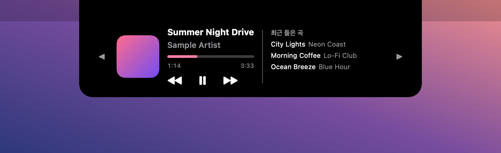
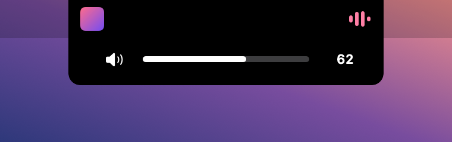
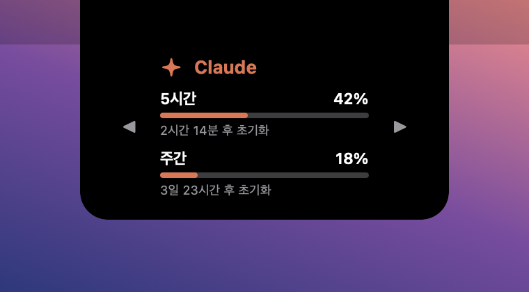
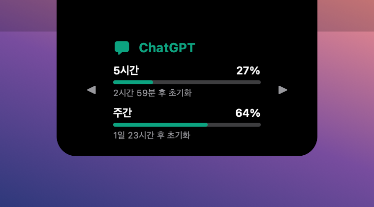
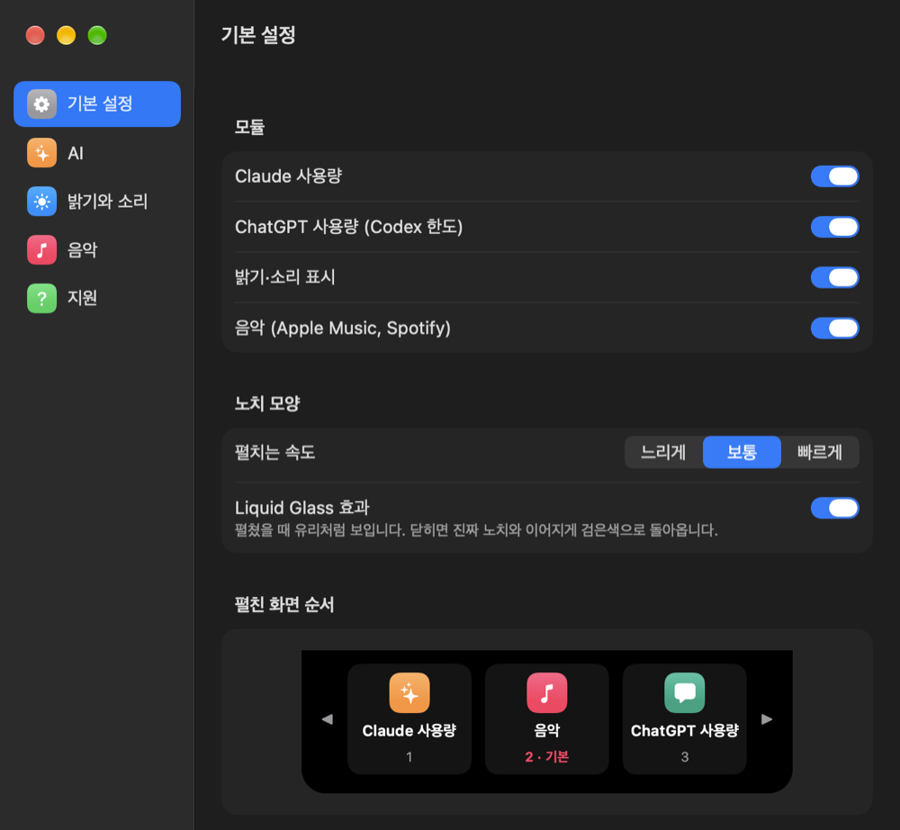
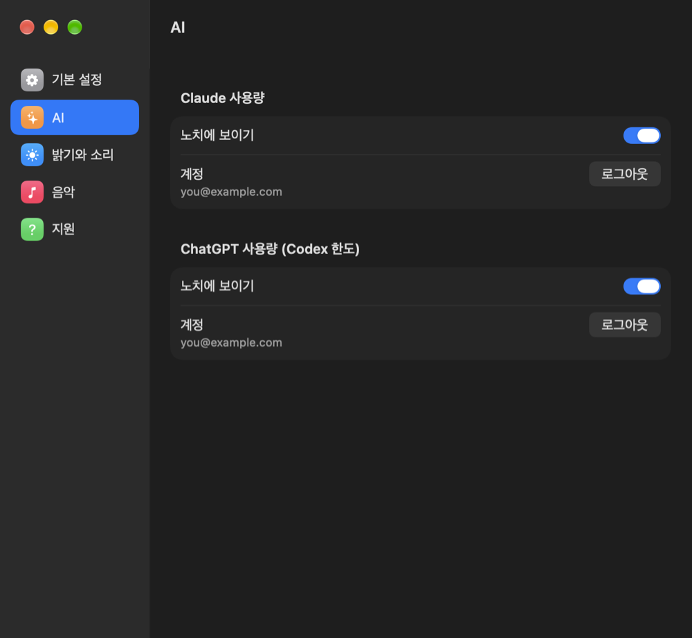
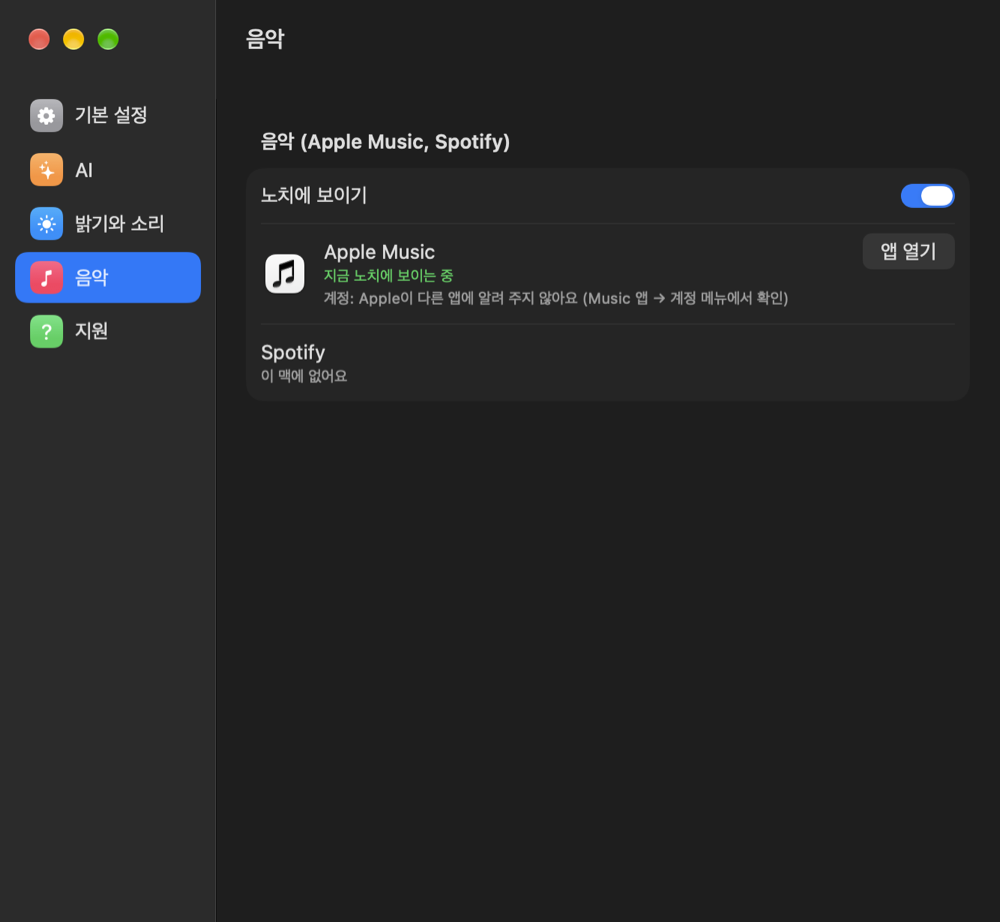
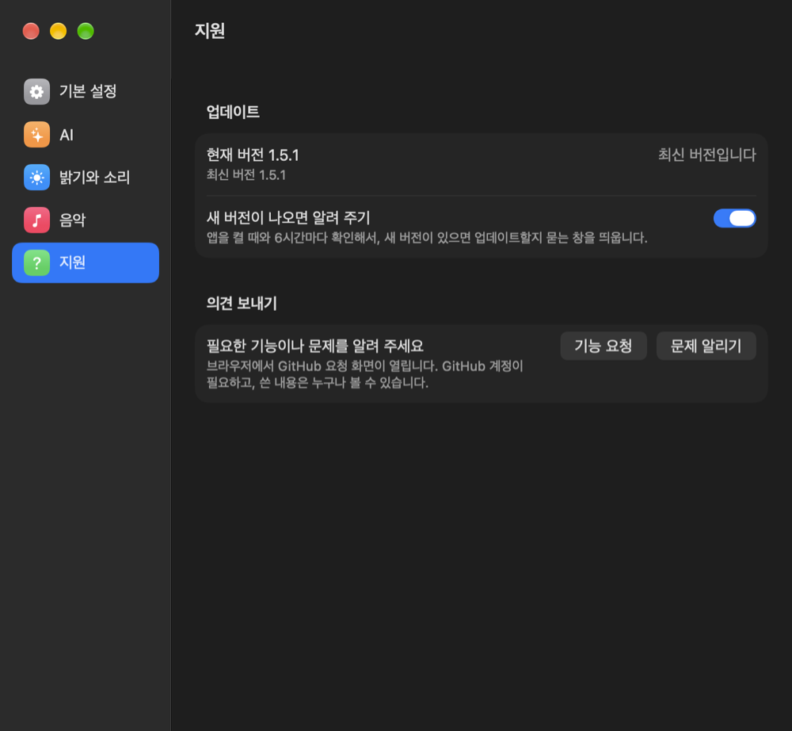

# ImNotNotch

**노치는 그냥 검은 칸이 아닙니다.** 맥북의 노치를 쓸모 있는 공간으로 바꿔 주는 무료 macOS 앱입니다. (노치를 숨기는 앱이 아닙니다.)

> 1.4.1까지는 **UsefulNotch**라는 이름이었습니다. 이미 쓰고 계시면 설정 → 지원 → 업데이트로 그대로 이어서 받을 수 있습니다.

노치 양옆에 재생 중인 음악을 작게 보여 주고, 마우스를 올리면 아래로 펼쳐져 여러 화면이 나타납니다.

## 둘러보기

| 닫혀 있을 때 | 밝기·소리를 바꿀 때 |
|---|---|
|  |  |
| 재생 중인 곡의 표지와, 장르에 맞춰 움직이는 막대 | 화면 오른쪽 위 대신 노치 아래에 |

| Claude 사용량 | ChatGPT 사용량 |
|---|---|
|  |  |
| claude.ai 구독의 5시간·주간 한도 | ChatGPT 구독의 Codex 5시간·주간 한도 |

펼친 화면은 ◀ ▶ 또는 트랙패드 두 손가락 좌우 쓸기로 넘깁니다.

### 설정

| 기본 설정 | AI |
|---|---|
|  |  |
| **음악** | **지원** |
|  |  |

> 사진 속 곡, 앨범 표지, 사용량, 계정은 예시입니다.

## 기능

- **음악** (Apple Music, Spotify): 앨범 표지, 곡 정보, 재생바, 이전·재생·다음, 노래 목록
- **Claude 사용량**: claude.ai 구독의 5시간·주간 한도
- **ChatGPT 사용량**: ChatGPT 구독의 Codex 5시간·주간 한도
- **밝기·소리 표시**: 밝기·소리 키를 누르면 화면 오른쪽 위 대신 노치 아래에 표시
- 펼친 화면은 ◀ ▶ 또는 트랙패드 두 손가락 좌우 쓸기로 넘김
- 설정 (시스템 설정처럼 왼쪽 목록: 기본 설정, AI, 밝기와 소리, 음악, 지원)
  - 기능 켜고 끄기, 펼치는 속도, Liquid Glass 효과(macOS 26 이상), 메뉴바 아이콘, 맥을 켜면 자동으로 시작
  - 펼친 화면 순서(노치 모양 그림에서 끌어서 바꾸기), 펼쳤을 때 보일 기본 화면과 마지막 화면 기억 시간
  - Claude·ChatGPT 계정 로그인·로그아웃, 음악 앱 연결 상태, 업데이트, 의견 보내기

## 설치

| 쓰는 컴퓨터 | 받을 곳 | 받을 파일 |
|---|---|---|
| **맥** | [맥 최신 릴리스](https://github.com/chihyeoi/ImNotNotch/releases/latest) (제목에 `Win`이 **없는** 것) | `ImNotNotch-버전.zip` |
| **윈도우** | [윈도우 최신 릴리스 (Win1.7.1)](https://github.com/chihyeoi/ImNotNotch/releases/tag/v1.7.1-win) | `ImNotNotch-windows-버전.zip` |

### 맥에 설치하기

macOS 14 이상, 노치가 있는 맥북에 맞춰 만들었습니다 (노치 없는 화면에서는 위 가운데에 비슷한 모양으로 나타납니다).

1. [맥 최신 릴리스](https://github.com/chihyeoi/ImNotNotch/releases/latest)에서 `ImNotNotch-버전.zip`을 내려받아 풉니다. (`windows`가 들어간 zip은 윈도우용이에요)
2. `ImNotNotch.app`을 **응용 프로그램** 폴더로 옮깁니다.
3. 앱을 엽니다. 처음엔 "확인할 수 없음" 같은 경고가 뜹니다. (애플 유료 공증을 받지 않은 앱이라 그렇습니다.)
   - **완료**를 누르고, 시스템 설정 → 개인정보 보호 및 보안 → 아래쪽의 **그래도 열기**를 누른 뒤 다시 엽니다. 한 번만 하면 됩니다.
4. 노치에 검은 판이 나타나면 성공입니다. 노치를 우클릭하면 설정을 열 수 있습니다.

**처음에 묻는 허락**

- **손쉬운 사용**: 밝기·소리 표시 기능에 필요합니다. 시스템 설정 → 개인정보 보호 및 보안 → 손쉬운 사용에서 ImNotNotch를 켜세요.
- **Music 제어**: 음악 기능이 재생 정보를 읽고 조작하는 데 필요합니다.
- Claude·ChatGPT 사용량은 노치를 펼친 뒤 각 칸의 **로그인**을 눌러 직접 로그인합니다. 로그인 정보는 이 맥의 앱 안에만 남습니다.

### 윈도우에 설치하기

윈도우 10(2004 이상)·윈도우 11. 윈도우 노트북엔 노치가 없어서, 화면 맨 위 가운데에 반투명한 얇은 막대가 나타나고 보여 줄 게 있을 때 노치 모양이 됩니다. 누른 채 끌어서 위치를 옮길 수 있어요.

1. [윈도우 최신 릴리스 (Win1.7.1)](https://github.com/chihyeoi/ImNotNotch/releases/tag/v1.7.1-win)에서 `ImNotNotch-windows-버전.zip`을 내려받습니다. (설치한 뒤에는 앱이 새 버전을 알아서 알려 줍니다)
2. 받은 zip을 우클릭 → **모두 압축 풀기**. 나온 **`ImNotNotch.exe`** 파일 하나를 **내 문서** 같은 곳에 둡니다. (`Program Files` 안에 두면 앱이 스스로 업데이트하지 못합니다)
3. **`ImNotNotch.exe`** 를 엽니다. (켜지는 데 몇 초 걸릴 수 있어요) 처음엔 파란 **"Windows의 PC 보호"** 창이 뜰 수 있습니다. (코드 서명을 받지 않은 앱이라 그렇습니다.)
   - **추가 정보 → 실행**을 누르면 열립니다. 한 번만 하면 됩니다.
4. 화면 맨 위 가운데에 얇은 막대(또는 검은 노치)가 나타나면 성공입니다. 노치를 우클릭하거나, 작업 표시줄 오른쪽(시계 옆, 또는 숨은 아이콘 `^` 안)의 아이콘을 누르면 설정을 열 수 있습니다.

**알아 두기**

- 윈도우를 켤 때 자동으로 켜지게 하려면: 설정 → 기본 설정 → 시작 → **윈도우를 켜면 자동으로 시작**.
- 음악: Spotify, 브라우저(유튜브 뮤직 등), 미디어 플레이어, Apple Music처럼 윈도우 소리 표시에 곡이 뜨는 앱이면 됩니다. 별도 허락은 필요 없습니다.
- Claude·ChatGPT 사용량은 설정 → AI → **로그인**으로 직접 로그인합니다. 로그인 정보는 이 PC(`%LOCALAPPDATA%\ImNotNotch`)에만 남습니다.
- 소리 키를 누르면 윈도우 기본 표시 대신 노치 아래에만 보입니다. 노트북 화면 밝기를 바꾸면 노치 아래에 밝기 막대도 보입니다 (밝기는 윈도우 기본 표시도 함께 떠요).
- 게임·영상을 전체 화면으로 볼 땐 노치가 숨습니다. 닫혔을 때 모양(얇은 막대/노치)과 이 동작은 설정 → 기본 설정 → 노치 모양에서 바꿀 수 있어요.

## 개인정보

- 앨범 표지를 찾을 때 애플의 공개 음악 검색에 곡 제목과 가수 이름을 보냅니다.
- Claude·ChatGPT 사용량은 로그인한 상태로 claude.ai, chatgpt.com에만 묻습니다.
- 설정 창의 업데이트 칸은 GitHub(api.github.com)에 최신 버전 번호를 묻습니다.
- 그 밖에는 어떤 정보도 밖으로 보내지 않습니다.
- Claude·ChatGPT 사용량은 공식으로 공개된 방법이 아니라 예고 없이 안 될 수 있습니다.

## 업데이트

새 버전이 나오면 업데이트할지 묻는 창이 뜨고, 설정의 **지원** 옆에 빨간 (1)이 붙습니다(1.4.1부터). 설정 → 지원의 **업데이트** 칸에서 현재 버전과 최신 버전을 볼 수 있습니다. 새 버전이 있으면 **업데이트**를 누르세요. 1.3부터는 앱이 새 버전을 직접 받아 바꿔 넣고 다시 켜집니다 (설정과 로그인은 그대로 남습니다).

1.2 이하를 쓰고 있다면 한 번만 직접 바꿔 주세요: 앱을 끄고(노치 우클릭 → 종료) 응용 프로그램 폴더의 예전 `UsefulNotch.app`을 휴지통으로 옮긴 뒤, 새 `ImNotNotch.app`을 넣으면 됩니다. 설정과 로그인은 그대로 남습니다.

## 의견 보내기

필요한 기능이나 문제는 앱 설정의 **의견 보내기**, 또는 이 저장소의 [Issues](https://github.com/chihyeoi/ImNotNotch/issues)에 남겨 주세요.

## 라이선스

무료로 내려받아 쓸 수 있지만 수정·재배포는 할 수 없습니다. [LICENSE](LICENSE) © 2026 김치형
